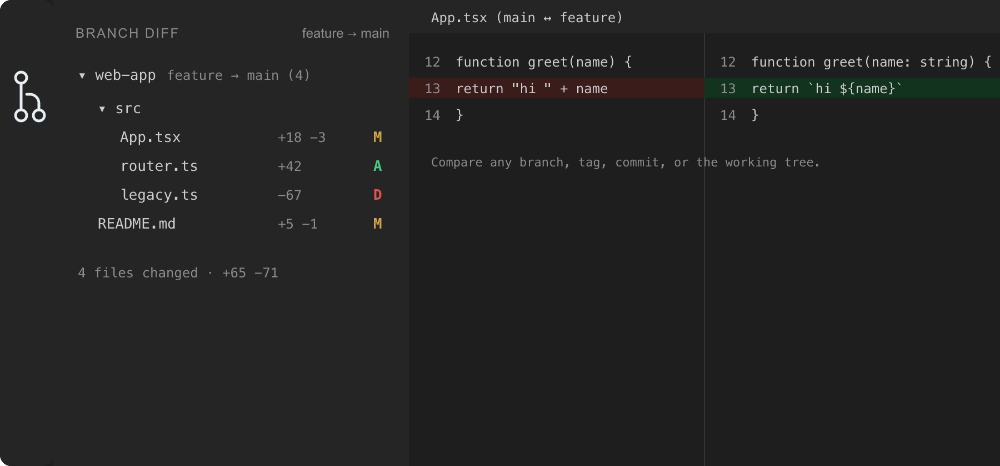

# Branch Diff

[](https://github.com/firdaushatta/git-branch-diff/actions/workflows/ci.yml)
[](LICENSE)
[](https://buymeacoffee.com/firdaushatta)

A VS Code extension that compares **all files** between two git branches and shows the changes for each file — like a local pull-request view.




## Install

Search **Git Branch Diff** in the Extensions view, or run:

```
ext install firdaushatta.git-branch-diff
```

See [Installation](#installation) below to build from source or a `.vsix`.

## Requirements

- VS Code `1.85.0` or newer
- `git` available on your `PATH`

## Features

- **Changed Files sidebar** — an Activity Bar view listing every file that differs between a source and target, with colored A / M / D / R status badges (matching VS Code's Source Control view), per-file `+/−` line counts, a compact folder tree, and a changed-file count badge.
- **Pick both sides** — compare any **source** against any **target**. Each side can be a branch, a **remote branch**, a **tag**, an arbitrary **commit / ref** (e.g. `HEAD~3`), or the **Working Tree** (uncommitted changes) as the source.
- **Swap** source ↔ target with one click.
- **Native diff editor** — click any file to open VS Code's side-by-side diff. When the source is the Working Tree, the diff opens against the live, editable file.
- **Merge-base (3-dot) comparison** by default, so you see only the changes introduced on the source (the same set GitHub shows in a PR). Toggle `branchDiff.useMergeBase` off for a direct 2-dot comparison against the target tip.
- **Source and target are remembered** per workspace.

## Usage

1. Open a git repository folder in VS Code.
2. Click the **Branch Diff** icon in the Activity Bar.
3. Run **Select Target Branch** (the `git-compare` icon in the view title) and pick a branch, tag, remote, or enter any ref.
4. Optionally run **Select Source Branch** (the `git-branch` icon) to compare from another branch, a ref, or the **Working Tree**.
5. Use **Swap** (the `arrow-swap` icon) to flip the two sides.
6. Browse the changed files; click one to open its diff. Use **Refresh** after committing.
7. To edit a file, hover its row and click **Open File** (the `go-to-file` icon), or right-click → **Open File** — this opens the real, editable file on disk. (When comparing two committed branches the diff itself is read-only; the Working Tree source opens against the live file.)
8. While reading a diff, **right-click a line** for line actions: **Open File at This Line** (jump into the editable file at that line), **Copy Line Reference** (`path:line`, or `path:start-end` for a selection), and **Copy Line** (the line's text).
9. Right-click any file (or folder) row for more actions: **Open to the Side**, **Copy Path**, **Copy Relative Path**, and **Reveal in Explorer**.

## Multiple repositories

If your workspace has more than one git repository (multi-root folders or nested repos — the same set VS Code's Source Control shows), each appears as its own header in the tree. Every repo keeps an **independent** source/target and is compared separately. Right-click a repo header to **Select Source / Select Target / Swap / Refresh** for just that repo; the toolbar buttons ask which repo when several are present. A single-repo workspace shows the file list flat, with no header.

## Settings

| Setting | Default | Description |
| --- | --- | --- |
| `branchDiff.useMergeBase` | `true` | Compare against the merge-base (3-dot). Disable to compare against the target branch tip (2-dot). |
| `branchDiff.groupByFolder` | `true` | Show changed files in a collapsible folder tree (single-child folders compacted). Disable for a flat list. |
| `branchDiff.includeUntracked` | `true` | When the source is the Working Tree, include untracked files as added. |

## Installation

Install from the [Marketplace](https://marketplace.visualstudio.com/items?itemName=firdaushatta.git-branch-diff), or build a `.vsix` locally:

```bash
npm install
npm run package
npx @vscode/vsce package                # produces git-branch-diff-<version>.vsix
code --install-extension git-branch-diff-*.vsix
```

## Development

```bash
npm install
npm run compile     # or: npm run watch
npm run check-types # type-check without emitting
npm test            # run unit tests
```

Press **F5** to launch the Extension Development Host.

Maintainers: see [PUBLISHING.md](PUBLISHING.md) for Marketplace release steps.

## Support

If this extension is useful to you, you can support its development:

<a href="https://buymeacoffee.com/firdaushatta">☕ Buy Me a Coffee</a>

## License

[MIT](LICENSE) © Firdaus Hatta
